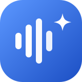

# Transcripteur IA by RJB

<br clear="left" />

Transcription audio → texte **100 % dans le navigateur** avec Whisper (Transformers.js 4.3.2).
Aucun serveur, aucune clé API, aucune installation : l’audio ne quitte jamais le PC.

## Lancer

Le site doit être servi en HTTP(S) (pas en `file://` : le cache des modèles et le service worker ne fonctionnent pas en local brut).

- **En ligne (recommandé)** : GitHub Pages, voir plus bas.
- **En local pour développer** : `python -m http.server 8080` dans ce dossier, puis http://localhost:8080

Navigateur conseillé : Chrome ou Edge récent (WebGPU activé par défaut sous Windows 11).

## Héberger gratuitement sur GitHub Pages

1. Crée un dépôt GitHub (public, ou privé avec un compte qui autorise Pages).
2. Envoie le contenu de ce dossier à la racine du dépôt (glisser-déposer dans l’interface web « Add file → Upload files » suffit).
3. *Settings → Pages → Build and deployment* : Source = « Deploy from a branch », branche `main`, dossier `/ (root)`.
4. Après 1 à 2 minutes, l’app est disponible sur `https://<ton-compte>.github.io/<depot>/`.

Le fichier `.nojekyll` évite tout traitement Jekyll.

## Architecture

```
index.html          Interface (3 zones : source → transcription → résultat)
styles.css          Design sombre
sw.js               Service worker : en-têtes COOP/COEP → WASM multithread sur GitHub Pages
js/config.js        Modèles, variantes WebGPU/WASM, langues, découpage, réglages V2
js/asr-worker.js    Web Worker : chargement Whisper, découpage 30 s / chevauchement 5 s, fusion, progression
js/app.js           Point d'entrée : branche l'interface et démarre l'appli (init)
js/ui/*.js          L'interface, par thème : core (outils communs, état), engine (worker), recording,
                    transcription, doc, doc-tabs, views, sound, diagnostic, notifs, speakers,
                    translation, history, dashboard, assistant, spaces, pages, account
js/assistant.js     Assistant : type de demande, choix des extraits, messages (fonctions pures)
js/insights.js      Tableau de bord et recherche dans les réunions (fonctions pures)
js/actions.js       Relevé de décisions et d'actions (fonctions pures)
js/report.js        Compte rendu : contenu, page PDF, fichier Word (fonctions pures)
js/verify.js        Vérification : passages à réécouter, comparaison des deux écoutes (fonctions pures)
js/calendar.js      Calendrier : fichiers .ics, événements Microsoft Graph (fonctions pures) ; js/outlook.js : connexion Microsoft
js/spaces.js        Espaces collaboratifs (Supabase) ; js/cloud.js : compte Google et Drive
tests/unit/         Tests des fonctions pures (node:test)
tests/e2e/          Tests dans un vrai navigateur (Playwright), avec faux Claude, Drive et Supabase
js/monitor.js       Graphique volume / compréhension en temps réel
js/calibration.js   Diagnostic de la pièce et score de dictée (fonctions pures)
js/live.js          Transcription en direct (Whisper par fenêtres, Voxtral en flux continu)
js/voxtral-engine.js Moteur Voxtral Realtime : flux continu, sessions de ~2 min, phrases horodatées
js/pcm-worklet.js   Capture de l'audio brut du micro (AudioWorklet) pour le direct
js/audio.js         Décodage (mp3, wav, m4a, webm, mp4…) en mono 16 kHz, enregistreur micro
js/lexicon.js       Lexique de corrections (localStorage)
js/exporters.js     .txt, .md, .srt
js/claude-export.js consigne de résumé et lien vers Claude
js/player.js        lecteur du résultat : forme d'onde, réécoute au clic, vitesse
js/translate.js     traduction locale : traducteur de Chrome, sinon modèle Opus-MT / NLLB
js/translate-worker.js  modèle de traduction (Transformers.js) dans son propre worker
js/history.js       Stockage local (IndexedDB) : transcriptions, audios, morceaux d'enregistrement
```

| Modèle | Dépôt Hugging Face | WebGPU | WASM (CPU) |
|---|---|---|---|
| Rapide | `onnx-community/whisper-base` | 206 Mo | 77 Mo |
| Équilibré | `onnx-community/whisper-small` | 586 Mo | 249 Mo |
| Précis | `onnx-community/whisper-large-v3-turbo` | 1,61 Go (759 Mo sans fp16) | 1,09 Go |
| Temps réel | `onnx-community/Voxtral-Mini-4B-Realtime-2602-ONNX` (Mistral, Apache 2.0) | 2,83 Go (3,18 Go sans fp16) | indisponible |

Les modèles sont téléchargés une seule fois puis gardés dans le cache du navigateur (Cache API).

## Tests automatiques

L'appli n'a besoin d'aucune compilation ; `package.json` ne sert qu'aux tests.

```bash
npm install
```

```bash
npx playwright install chromium
```

```bash
npm test
```

- `npm run test:unit` : fonctions pures (recherche, assistant, relevé d'actions, exports, lexique, voix, couleurs…), en une seconde.
- `npm run test:e2e` : l'appli dans Chromium : démarrage et navigation, téléphone (aucun débordement), réunion (onglets, actions, export), assistant (recherche simple, Claude simulé en quiz sur deux tours, périmètre), espaces (faux Supabase : création, invitation, partage, droits), Google Drive (faux Drive : envoi puis récupération sur un autre appareil), micro (faux micro) et import de fichier. Aucun vrai compte ni clé n'est utilisé.
- Sur GitHub, les tests tournent à chaque pull request (onglet **Actions**, workflow « Tests ») : une PR rouge signale une régression avant la fusion.

## Transcription en direct

Toujours active quand on enregistre au micro (plus d'interrupteur). Toutes les ~3 s, la partie non validée est retranscrite ;
les phrases terminées sont validées, la dernière reste provisoire (en italique). À l'arrêt, la fin est
retranscrite normalement pour une qualité maximale. Décalage typique : 3 à 6 s avec le modèle Rapide.

## Vrai temps réel avec Voxtral

Modèle « Temps réel » (Voxtral Realtime de Mistral) : modèle conçu pour le flux continu, le texte suit
la parole avec ~0,5 s de décalage, sans re-transcription à l'arrêt. Taux d'erreur publié en français :
6,4 % (FLEURS, 480 ms de décalage). Langue détectée automatiquement.

- Carte graphique (WebGPU) obligatoire ; grisé sinon.
- 2,8 Go à télécharger une fois.
- Le cache du modèle grossit avec la durée : la transcription est découpée en sessions de ~2 min
  coupées sur un silence, pour ne pas saturer la mémoire d'une carte graphique intégrée.
- Sur une carte graphique d'entrée de gamme (Intel intégrée), il peut ne pas suivre le rythme de la
  parole : l'indicateur « retard » le signale, et le texte est complété à l'arrêt.

## Moniteur (volume et compréhension)

Panneau à droite (en haut à droite sur écran moyen) qui défile sur les 30 dernières secondes :
- **Volume** du micro en dBFS, avec la zone idéale en vert et les saturations en rouge.
  Diagnostic sur 6 s : Bon niveau / Un peu faible / Trop faible / Trop fort / Aucune voix (après 8 s).
- **Compréhension du modèle** (mode direct) : probabilité moyenne que le modèle accorde aux mots
  qu'il écrit. ≥ 80 % bonne, 60–80 % moyenne, < 60 % faible.
- Dans le résultat, les passages sous 60 % sont soulignés « à vérifier » ; le soulignement disparaît
  quand tu corriges le passage. La confiance moyenne est affichée sous le titre.
- **Relecture** : dès que tu lances la lecture d'un audio, le graphique suit la position
  (20 s avant, 10 s après, tête de lecture). Il suit aussi les déplacements, même en pause.
  La compréhension affichée est celle de chaque phrase transcrite. Le direct reprend la main
  dès qu'un enregistrement ou un test du micro démarre.

Limite : c'est la confiance du modèle, pas une garantie. Il peut se tromper avec assurance
(noms propres, sigles), d'où le lexique.

## Réglages du son (sous le graphique)

- **Tester le micro** : affiche le niveau sur le graphique sans rien enregistrer.
- **Micro** : choix du périphérique (les noms apparaissent après la première autorisation).
  Un appareil éteint reste choisi (« non connecté ») ; alerte s'il manque ou se déconnecte.
  Micro Bluetooth (AirPods) : le casque passe en mode « mains libres », qualité moindre.
- **Sortie** : où écouter la relecture (casque, haut-parleurs), avec bouton « Tester » (Chrome, Edge).
- **Gain** de −12 à +24 dB, modifiable pendant l'enregistrement, appliqué au son enregistré et transcrit.
- **Ajuster automatiquement** : règle le gain pour que la voix soit vers −20 dBFS (crêtes plafonnées à −3 dBFS).
- **Gain automatique**, **réduction du bruit**, **annulation d'écho** (traitements du navigateur) :
  changent au prochain démarrage du micro.
- **Filtre des basses** : coupe les grondements sous 90 Hz, modifiable à tout moment.
- Réglages mémorisés dans le navigateur ; bouton « Réglages par défaut ».

## Enregistrer une visio (Teams, Meet, Zoom)

Au-dessus du bouton d'enregistrement :

- **Ma voix** : le micro seul (réunion en salle, dictée).
- **Voix + visio** : le micro et le son des autres participants, mélangés.
- **Visio seule** : uniquement le son partagé (webinaire, vidéo, visio où l'on ne parle pas).

Au démarrage, Chrome ouvre la fenêtre de partage :

- **visio dans le navigateur** : choisir l'onglet et cocher « Partager l'audio de l'onglet » ;
- **application Teams ou Zoom** : choisir « Écran entier » et cocher « Partager l'audio du système » (Windows).

L'image n'est pas gardée, seul le son l'est. Avec un casque, pas d'écho ; avec des haut-parleurs,
le micro capte aussi la visio (voix en double). Chrome et Edge sur ordinateur uniquement.

### Vidéo de l'écran (option)

En « Voix + visio » ou « Visio seule », l'option **Garder la vidéo de l'écran** enregistre aussi l'image partagée
(qualité réunion : 720p, 5 images/s, ≈ 350 kbit/s, soit ≈ 150 Mo par heure selon ce qui bouge à l'écran).

- sauvegardée par morceaux pendant l'enregistrement, comme le son (récupérée si l'onglet plante) ;
- dans le projet, **Écran enregistré** (panneau de droite) : la vidéo suit le lecteur — clic sur une phrase, la vidéo
  saute au même moment ; plein écran, incrustation (par-dessus les autres fenêtres), **supprimer la vidéo** (le son est gardé) ;
- **sauvegardée dans Google Drive** (compte connecté ; option dans Paramètres → Compte Google, activée par défaut) :
  fichier « <titre> · écran.webm » dans le dossier « Transcripteur IA », lisible directement dans Drive ;
  « Libérer la place sur ce PC » efface la copie locale (retéléchargée à la demande, aussi sur un autre appareil) ;
  supprimer la vidéo l'efface aussi de Drive ; pas envoyée dans les espaces partagés ;
- partage d'un onglet (Teams dans le navigateur) : seule la réunion est filmée ; « Écran entier » : tout l'écran.
- Filmer une visio, comme l'enregistrer : préviens les participants.

## Réglage automatique (activé par défaut)

Quand tu lances un enregistrement :

1. **Modèle choisi selon le PC** (instantané) : « Équilibré » si la carte graphique est exploitable
   (WebGPU) et qu'il y a au moins 4 Go de mémoire, sinon « Rapide ». Si tu choisis un modèle à la main,
   ton choix est respecté.
2. **Diagnostic du son (3 s de silence)** avec le micro brut :
   - mesure du bruit de fond, type de micro (PC portable, Bluetooth, externe) et sortie (casque ou
     haut-parleurs) ;
   - réglage de l'anti-bruit, de l'anti-écho (inutile avec un casque) et du filtre des basses (micro du
     PC, pièce bruyante) ; le gain automatique reste activé ;
   - le résultat est **gardé 1 h pour le même micro** : les enregistrements suivants démarrent tout de
     suite. « Refaire le diagnostic » relance la mesure.
3. **Pendant l'enregistrement**, toutes les 5 s, le gain est corrigé si la voix est trop faible ou
   sature (±6 dB maximum par correction).

Modifier un réglage du son à la main désactive le réglage automatique pour garder ton choix. Pendant
un enregistrement, ça arrête seulement la correction du gain.

## Optimiser la qualité (micro du PC portable)

Dans les réglages du son :
- **Optimiser pour le micro du PC** : réduction du bruit, annulation d'écho, gain automatique et filtre
  des basses activés en un clic.
- **Diagnostic de la pièce** (~15 s) : 3 s de silence puis une phrase lue, avec le micro brut. Mesure le
  bruit de fond, l'écart voix / bruit et estime l'écho (vitesse à laquelle le son retombe après chaque mot),
  avec verdict et conseils.
- **Calibrer par dictée** (~1 min) : 3 phrases lues, chacune avec un réglage différent ; chaque lecture
  est transcrite et comparée à la phrase (pourcentage de mots justes, mots mal compris surlignés).
  À moins de 3 points d'écart, le réglage recommandé est conservé.

Limites : l'écho est une estimation indicative ; deux lectures ne sont jamais identiques, seuls des écarts
nets entre réglages sont significatifs.

## Interface

Fond photo flouté et panneaux en **verre dépoli** (violet), en mode **clair** et **sombre** (interrupteur soleil / lune en haut ; par défaut, celui de Windows).

- **Barre latérale** :
  - **Accueil** : tableau de bord (voir ci-dessous) ;
  - **Mes projets** et **Historique** : les transcriptions enregistrées ;
  - **Analyses** : volume par semaine, temps de parole par personne, sujets, **actions en cours** de toutes les réunions ;
  - **Modèles** : les modèles de transcription, leur taille, s'ils sont téléchargés, et le choix du modèle ;
  - **Paramètres** (compte, voix connues, moteur, lexique, stockage) et **Aide** (questions courantes).
  - En bas, le **compte Google** (connexion, état de la synchronisation).
- **Changer de compte Google** : clic sur ton profil (en bas à gauche) → les comptes déjà utilisés sur ce navigateur s'y affichent, un clic pour basculer ; « Utiliser un autre compte » ouvre le choix de Google. Chaque compte retrouve ses propres transcriptions et dossiers. (Téléphone : Paramètres → Compte Google → Changer de compte.)
- **Accueil (tableau de bord)** :
  - c'est la page d'arrivée ; « Bonjour » avec ton prénom (compte Google), boutons **Nouvelle transcription** et **Importer un fichier** ;
  - 4 chiffres : transcriptions, audio traité, projets (dossiers) ou voix connues, compréhension moyenne, avec l'évolution sur 7 jours ;
  - **derniers projets** : écouter, ouvrir, ou menu (décisions et actions, résumer avec Claude) ;
  - **insights** : audio traité sur 7 jours (courbe), sujets principaux (mots-clés BIM, technique, organisation, chantier), actions extraites ;
  - à droite, **Analyse rapide** (qui parle le plus, sur la semaine, le mois ou depuis le début) et l'**Assistant**.
- **Assistant IA** : pose une question (« Quelles décisions sur le projet Ledona ? », « Qui doit envoyer les plans, et pour quand ? »).
  1. il cherche les extraits utiles de tes réunions (décisions, actions, passages ; « cette semaine », « hier »… limitent la période) ;
  2. un modèle de langage rédige la réponse en citant ses sources (numéros cliquables qui ouvrent le passage).
  - **Types de demandes** reconnus, avec une consigne adaptée : question précise, **synthèse** (« résume ce dossier », « fais le point »), **quiz** (« questionne-moi sur ce dossier » : une question à la fois, correction avec la source, score), **rédaction** (« rédige un mail à Julie… »), liste de décisions ou d'actions.
  - Pour une synthèse, un quiz ou une rédaction, il lit un aperçu de **toute** la réunion ou du dossier (morceaux répartis du début à la fin, et le résumé écrit s'il y en a un), pas seulement les passages qui contiennent les mots de la question.
  - **Conversation suivie** : une réponse au quiz, « développe », « et pour le lot 3 ? » reprennent les mêmes extraits et les échanges précédents (toute la conversation avec Claude, les derniers échanges avec un modèle local). Changer de périmètre repart de zéro.
  - **Moteur** (Paramètres → Assistant IA) :
    - *Local, automatique* (par défaut) : avec une carte graphique (WebGPU), **Qwen3 1,7B** (≈ 1,4 Go, téléchargé une fois après accord), rien ne quitte l'appareil. Sans carte graphique compatible : recherche dans les réunions, sans réponse rédigée (le 1,7B ne tient pas en mémoire sur le processeur) ;
    - *Local avancé* : **Qwen3 4B** (≈ 2,8 Go, carte graphique récente avec demi-précision, environ 4 Go de mémoire graphique). Nettement meilleur que le 1,7B pour raisonner et suivre les consignes, plus lent ; si la carte ne suit pas, l'appli repasse au 1,7B ;
    - *Local léger* (expérimental) : **Qwen3 0,6B** sur le processeur (≈ 620 Mo). Fonctionne partout mais réponses souvent approximatives, 20 s à 2 min ;
    - *Claude* : avec ta clé API Anthropic (compte API, payant à l'usage, distinct de l'abonnement claude.ai). **Le plus intelligent** (Opus 5.5 par défaut, réflexion « moyenne »). Jusqu'à environ 60 000 caractères d'extraits et la conversation sont envoyés à Anthropic ; ils sont mis en cache, donc les questions suivantes d'une même conversation coûtent bien moins cher. Clé gardée dans le navigateur uniquement ;
    - *Recherche simple* : mots-clés seulement, sans modèle.
  - **Projet questionné** : la pastille « Sur : … » sous la conversation (ou **@** dans le champ) ouvre une fenêtre pour choisir un dossier (un projet) ou une réunion précise, avec recherche. L'assistant ne cherche alors que dedans, et lit le texte de tout le périmètre (en entier s'il est petit, sinon un aperçu réparti). La croix revient à toutes les réunions ; le menu ⋮ d'une réunion récente propose aussi « Interroger l'assistant ».
  - Les petits modèles locaux peuvent se tromper : vérifie dans les sources citées.
  - Si le modèle précis ne démarre pas sur la carte graphique, l'appli essaie le modèle léger sur la carte graphique, puis passe en recherche simple. **Tester l'assistant** (Paramètres) lance le modèle sur une question courte et donne un rapport à copier (carte, format, erreur exacte) ; **Oublier les échecs** permet de retenter.
- **Personnalisation** : couleur d'accent (onglet sélectionné, boutons, liens : 10 couleurs ou couleur libre, adaptée au mode clair et sombre), fond d'écran (photo, dégradés, ou ta propre image, réduite et gardée dans le navigateur), flou du fond, assombrissement (éclaircissement en mode clair) et opacité des panneaux. Appliqué tout de suite, gardé dans ce navigateur.
- **Nouvelle transcription** : la page d'enregistrement (source, réglage automatique, modèle, langue) avec, à droite,
  le moniteur et les réglages du son.
- **En haut** : recherche dans les transcriptions, thème, **notifications** et menu **Exporter** (.txt, .md, .srt, copier, Résumer avec Claude).
- **Notifications (cloche)** :
  - événements signalés : transcription terminée, voix reconnues, traduction terminée, enregistrement récupéré, transcription interrompue, synchronisation en erreur, reconnexion Google, synchronisation rétablie ;
  - un clic ouvre la transcription concernée ;
  - option : notification Windows quand l'appli est en arrière-plan.
- **Vue transcription** (ouverte automatiquement pendant un enregistrement ou une transcription) :
  - titre modifiable et pastilles d'infos ;
  - barre d'enregistrement (pause, arrêt) quand le micro tourne ;
  - 4 onglets :
    - **Transcription** : intervenants à gauche ; texte par prise de parole avec sa plage horaire ;
    - **Analyse** : durée, mots, débit, temps de parole par personne, passages à vérifier cliquables ;
    - **Résumé IA** : envoi à Claude, et zone pour garder le résumé avec la transcription ;
    - **Traduction** : traduire, et choix de l'affichage (original, français, les deux) ;
  - **Mode édition** (correction directe du texte, ou lecture seule) et **plein écran** ;
  - le **lecteur** : forme d'onde cliquable, repères des passages à vérifier, volume, vitesse.
- **Panneau « Analyse audio »** :
  - moniteur (direct et relecture) ;
  - **répartition des intervenants** (donut) ;
  - **qualité de la transcription** : jauge de confiance du modèle et passages à vérifier ;
  - réglages du son, optimisation, raccourcis.

**Sur téléphone** (écran de moins de 760 px) :

- navigation en bas (Accueil, Mes projets, Historique, **Analyse**, Paramètres) et une seule barre en haut ;
- l'onglet **Analyse** ouvre en plein écran le moniteur, les intervenants, la qualité et les réglages du son ;
- dans une transcription : intervenants en bandeau horizontal, texte en pleine largeur, onglets qui
  défilent, lecteur collé en bas de l'écran ;
- les zones réservées de l'iPhone (encoche, barre du bas) sont respectées ;
- sur téléphone, la transcription est nettement plus lente : le réglage automatique y choisit « Rapide ».

Raccourcis : `Espace` pause de l'enregistrement ou lecture/pause ; `Ctrl + Espace` lecture/pause même pendant
la correction du texte ; `Ctrl + Entrée` transcrire ; `Ctrl + F` rechercher ; `Échap` fermer ou effacer la recherche.

## Langue détectée et traduction automatique en français

Par défaut, la langue est **détectée automatiquement** (choix « Détection automatique de la langue » sous le modèle)
et l'option **« Traduire en français automatiquement »** est activée :

- Whisper détecte la langue de chaque bloc de 30 s (limitée aux 14 langues de l'application ; le français l'emporte
  en cas de doute). Une réunion qui mélange français et anglais est gérée ; chaque phrase garde sa langue (étiquette « EN »…).
  Avec Voxtral, la langue est devinée à partir du texte.
- Les phrases dans une autre langue sont **traduites toutes seules** : à la fin d'une transcription, et **en direct**
  pendant l'enregistrement. Les phrases en français ne sont pas touchées ; une transcription 100 % française reste identique.
- Affichage : **langue d'origine / Français / Les deux**. Copier, exporter et Résumer avec Claude utilisent le texte affiché.
- Moteur : traducteur intégré de Chrome s'il répond, sinon modèle local (Opus-MT ≈ 107 Mo pour en/es/de/it/nl/ro/ru ;
  NLLB-200 ≈ 900 Mo pour les autres langues, téléchargé seulement après accord). Rien n'est envoyé sur Internet.
- Le bouton **Traduire** reste disponible pour traduire à la main (ex. si l'option automatique est coupée).
- Limites : au changement de langue, une phrase à cheval sur deux blocs peut être mal transcrite ; les petits modèles
  traduisent mal le jargon technique (« clashes » → « affrontements »).

## Qui parle ? (intervenants)

Après chaque transcription (option « Reconnaître qui parle », ou bouton **Qui parle ?**) :

1. **pyannote-segmentation-3.0** repère, par tranches de 10 s, quand chaque voix parle ;
2. **WeSpeaker ResNet34** calcule l'empreinte de chaque voix (≈ 33 Mo pour les deux modèles, téléchargés une fois) ;
3. les empreintes semblables sont regroupées : une couleur et un nom par personne ;
4. chaque phrase est attribuée à la personne qui parle le plus pendant cette phrase. Une phrase
   partagée par deux personnes est coupée à la ponctuation la plus proche du changement de voix.

Ensuite :

- **renommer** : clique sur un nom dans la barre des intervenants ;
- **corriger** : clique sur l'étiquette d'une prise de parole pour l'attribuer à quelqu'un d'autre ;
- **forcer le nombre de personnes** (« Personnes : 2, 3… ») si l'analyse s'est trompée :
  le recalcul est instantané.

Les noms sont repris dans les exports (« Nom : texte ») et dans « Résumer avec Claude ».
Tout reste local. Durée de l'analyse : de l'ordre de 1 min pour 10 min d'audio sur le processeur.

Limites :

- deux voix proches (même timbre) peuvent être confondues ;
- les très courtes interventions (« oui », « d'accord ») sont rattachées à la phrase autour ;
- une parole simultanée (deux personnes en même temps) n'est pas séparée.

### Voix connues (reconnaissance d'une réunion à l'autre)

Quand tu renommes un intervenant (« Personne 1 » → « Julie »), l'empreinte moyenne de sa voix
est gardée dans un **carnet de voix**, dans ce navigateur. Aux réunions suivantes, chaque voix
est comparée au carnet : si elle ressemble assez à une voix connue, elle prend son nom.

- prudent par conception : en cas de doute (ressemblance trop faible, ou deux noms possibles),
  la voix reste « Personne N » plutôt que de recevoir un mauvais nom ;
- chaque nouveau renommage affine la voix (micro, pièce différents) ;
- Paramètres → **Voix connues** : liste des voix, « oublier » une voix ou tout le carnet,
  interrupteur pour désactiver la reconnaissance.

Le carnet reste dans le navigateur (il n'est pas synchronisé). L'empreinte de chaque intervenant
est aussi gardée dans la transcription, pour pouvoir l'apprendre plus tard.

## Décisions et actions (onglet « Actions »)

L'onglet **Actions** d'une transcription relève, sur ton PC et sans IA, par des règles de langue :

- les **décisions** : « on valide », « on part sur », « c'est acté », « on garde »… ;
- les **actions** : « il faut », « tu peux… ? », « je m'en occupe », « je t'envoie »,
  « Marc va exporter… » ;
- **qui** : le prénom cité (« Julie, tu… »), sinon la personne qui parle (« je… ») ou celle qui
  répond à une demande (« pas de souci, je m'en charge ») ;
- **pour quand** : « vendredi », « demain », « d'ici la fin du mois », « le 12 mars »…, converti
  en date réelle d'après le jour de la réunion.

Coche une action quand elle est faite, retire (×) ce qui n'en est pas une : ces choix sont
gardés avec la transcription. **Copier** donne le relevé en Markdown (mail, Teams, Notion).
Le repérage par règles est volontairement prudent et rate des formulations ; pour un relevé
complet et reformulé, **Affiner avec Claude** ouvre Claude avec une consigne dédiée
(décisions, tableau action / responsable / échéance, points en suspens).

## Espaces partagés (collaboratif, facultatif)

Onglet **Espaces** : un espace = un groupe de personnes qui partagent des réunions (un projet, une équipe, la famille).

- le propriétaire crée l'espace et **invite par adresse e-mail** (Google) ; la personne le voit dès sa connexion
  dans l'onglet Espaces avec cette adresse (aucun e-mail n'est envoyé : « Copier l'invitation » prépare le message) ;
- **Partager une transcription** envoie le texte, les intervenants et, au choix, l'**audio compressé en qualité voix**
  (Opus mono ≈ 24 kbit/s, ≈ 11 Mo par heure, fait dans le navigateur) ; les empreintes de voix ne sont pas partagées ;
- **Ouvrir** une réunion d'un espace en fait une copie dans « Mes projets » (badge du nom de l'espace), avec son audio :
  écoute, onglet Actions, assistant… ;
- l'auteur ou le propriétaire peut retirer une réunion ; le propriétaire peut retirer un membre, renommer ou supprimer
  l'espace ; un membre peut quitter l'espace.

**Confidentialité** : contrairement au reste de l'appli, ce qui est partagé dans un espace est stocké sur le serveur
Supabase configuré. Les règles d'accès (`supabase/schema.sql`) limitent la lecture aux membres de l'espace.

### Mise en place (une fois, ≈ 10 min, gratuit)

1. Créer un projet sur [supabase.com](https://supabase.com/dashboard) (région Europe).
2. SQL Editor → coller [`supabase/schema.sql`](supabase/schema.sql) (bouton « Copier le script SQL » dans l'onglet Espaces) → **Run**.
3. Authentication → Sign In / Providers → **Google** : activer, coller l'ID client et le code secret du client OAuth
   (Google Cloud → API et services → Identifiants) ; dans Google Cloud, ajouter à ce client l'URI de redirection
   `https://<projet>.supabase.co/auth/v1/callback`.
4. Authentication → URL Configuration : *Site URL* et *Redirect URLs* = l'adresse de l'appli
   (`https://rafjtb.github.io/Transcripteur-IA/`).
5. Project Settings → API : coller l'URL du projet et la clé **anon / publishable** dans l'onglet Espaces
   (ou dans `js/config.js` : `SUPABASE_URL`, `SUPABASE_ANON_KEY`, pour tous les utilisateurs). Jamais la clé `service_role`.

Palier gratuit Supabase : 500 Mo de base, 1 Go de fichiers (≈ 90 h d'audio compressé), 50 Mo par fichier ;
le projet se met en pause après 7 jours sans activité (réactivation d'un clic dans le tableau de bord).

### Conversation d'un espace

Chaque espace a sa **Conversation** (à droite des membres et des réunions, ou au-dessus quand la place manque) :
- messages entre les membres, qui arrivent **en direct** (Supabase Realtime, inclus dans l'offre gratuite) ; si le direct est coupé, les messages sont relus toutes les 20 secondes (« reconnexion… ») ;
- **Entrée** envoie, **Maj + Entrée** va à la ligne ; les liens sont cliquables ;
- trombone : **joindre une réunion** partagée de l'espace (un clic l'ouvre) ;
- **non-lus** : pastille sur l'espace et sur « Espaces » dans le menu, notification dans la cloche (et notification du système si elle est activée) ; comptés aussi à l'ouverture de l'appli ;
- l'auteur d'un message, ou la propriétaire de l'espace, peut le supprimer (il disparaît pour tout le monde).

**Mise à jour du projet Supabase** : la conversation utilise une nouvelle table. Recopie le script (onglet Espaces → *Copier le script SQL*, ou `supabase/schema.sql`) dans **SQL Editor → Run** : il est ré-exécutable sans danger, il ajoute la table `space_messages`, ses règles d'accès (seuls les membres lisent et écrivent) et l'active pour le direct.

## Calendrier (Outlook ou fichier .ics)

L'onglet **Calendrier** affiche tes réunions de la semaine (navigation semaine par semaine). Sur chaque réunion :
- **Enregistrer** : ouvre « Nouvelle transcription » avec la réunion reliée (bandeau « Réunion du calendrier », croix pour ne pas relier) ; la transcription prend le **titre** de la réunion et garde ses horaires, participants et lien de visio ;
- **Rejoindre** : ouvre le lien Teams, Meet ou Zoom ;
- **Transcription** : ouvre celle déjà faite pour cette réunion.

Aussi :
- un enregistrement lancé **pendant** une réunion du calendrier (ou 10 min avant) s'y relie tout seul ;
- l'**Accueil** affiche la **prochaine réunion** (Rejoindre, Enregistrer) ;
- **rappel** 2 minutes avant chaque réunion (notification, appli ouverte), désactivable ;
- dans **Qui parle ?**, les participants de la réunion sont proposés comme noms.

Deux sources :
- **Outlook / Microsoft 365** (mis à jour tout seul, relu au démarrage s'il date de plus de 30 min, bouton Actualiser) : connexion Microsoft en **lecture seule** (`Calendars.Read`, `User.Read`), OAuth « code + PKCE » directement depuis le navigateur, sans serveur ni secret. À faire une fois : inscrire l'appli dans [Microsoft Entra → Inscriptions d'applications](https://entra.microsoft.com/#view/Microsoft_AAD_RegisteredApps/ApplicationsListBlade) (gratuit) : comptes « annuaire organisationnel **et** comptes Microsoft personnels », URI de redirection de type **Application monopage (SPA)** = l'adresse du site (`https://rafjtb.github.io/Transcripteur-IA/`), puis coller l'**ID d'application (client)** dans l'onglet Calendrier (ou dans `OUTLOOK_CLIENT_ID` de `js/config.js`). Un compte professionnel ou d'école peut exiger l'**accord de l'administrateur** : l'appli l'explique et propose le fichier .ics. La session Microsoft d'une appli web dure 24 h, ensuite « Se reconnecter » ; l'agenda déjà lu reste affiché.
- **Fichier .ics** (export Outlook, Google Agenda…) : lecture des fuseaux horaires (y compris les noms Windows d'Outlook), des réunions répétées (quotidiennes, hebdomadaires, mensuelles « 2e mardi »…), des exceptions et occurrences déplacées, des annulations. Pas de mise à jour automatique.

## Compte Google, dossiers et synchronisation (facultatif)

Sans compte, tout reste dans le navigateur, comme avant. Avec un compte Google :

- **Comptes séparés** : chaque personne voit uniquement ses transcriptions, même si plusieurs comptes
  utilisent le même PC.
- **Où sont les données** : transcriptions, audios et dossiers sont copiés dans le **Google Drive de la
  personne**, dossier « Transcripteur IA ». Elle les retrouve sur tous ses appareils.
- **Accès limité** : l'appli demande seulement l'accès `drive.file`. Elle ne voit **que les fichiers
  qu'elle a créés**, jamais le reste du Drive. Aucun serveur intermédiaire : personne d'autre n'a accès
  aux données.
- **Dossiers** : dans « Mes projets », crée, renomme ou supprime des dossiers. Le menu de chaque carte
  (ou celui du document ouvert) range une transcription dans un dossier.
- **Synchronisation** :
  - quelques secondes après chaque modification, toutes les 3 minutes, et au retour sur l'onglet ;
  - en cas de modification des deux côtés, la plus récente gagne ;
  - une suppression est appliquée partout.
- **Audio** : il est envoyé une fois. Sur un autre appareil, il n'est téléchargé que si tu ouvres la
  transcription.
- **Première connexion** : propose d'ajouter au compte les transcriptions faites sans compte.
- **Déconnexion** : les transcriptions du compte sont masquées. Une case permet de les effacer du
  navigateur (conseillé sur un PC partagé).
- **Transcription** : elle reste entièrement faite sur le PC.

La connexion se fait **par redirection** (OAuth 2.0 pour application web côté client) et non par une
fenêtre surgissante, incompatible avec l'isolation COOP/COEP qui permet le calcul multithread.

### Mise en place (une fois, par l'administrateur, ≈ 15 min)

1. [console.cloud.google.com](https://console.cloud.google.com) : créer un projet « Transcripteur IA ».
2. **API et services → Bibliothèque** : activer **Google Drive API**.
3. **Écran de consentement OAuth** (Google Auth Platform) :
   - type **Externe**, nom « Transcripteur IA », e-mail d'assistance ;
   - accès aux données : ajouter les champs d'application `openid`, `email`, `profile` et
     `…/auth/drive.file` ;
   - public cible : en mode **Test**, ajouter l'adresse Gmail de chaque ami (100 au maximum).
4. **Clients → Créer un client** de type **Application Web** :
   - origine JavaScript autorisée : `https://rafjtb.github.io` ;
   - URI de redirection autorisé : l'adresse exacte du site, affichée dans l'appli
     (**Paramètres → Compte Google → Configuration**), par exemple `https://rafjtb.github.io/Transcripteur-IA/`.
     Le `/` final compte.
5. Copier l'**ID client** (`…apps.googleusercontent.com`). Ce n'est pas un secret. Ensuite :
   - pour tester tout de suite : le coller dans **Paramètres → Compte Google → Configuration** ;
   - pour tout le monde : le mettre dans `GOOGLE_CLIENT_ID` (`js/config.js`).

En mode Test, seuls les comptes ajoutés à l'étape 3 peuvent se connecter. Google peut aussi demander
de se reconnecter plus souvent : l'appli le fait automatiquement au démarrage quand c'est possible,
sinon elle affiche « Reconnexion nécessaire ».

## Compte rendu (Word ou PDF)

**Exporter → Compte rendu** (ou le bouton **Compte rendu** de l'onglet Actions) fabrique un document propre à envoyer après la réunion, sur l'appareil :
- en-tête : titre, date et heure, durée, participants (noms de « Qui parle ? »), projet (dossier) ;
- **Résumé** : le texte de l'onglet Résumé IA (le Markdown collé depuis Claude est mis en forme : titres, puces, gras) ;
- **Décisions** et tableau des **Actions** (responsable, échéance, fait / à faire), repris de l'onglet Actions : ce qui y est retiré n'apparaît pas, ce qui est coché est barré ;
- **Transcription en annexe** (facultatif, avec ou sans les heures), sur une nouvelle page.

Formats :
- **Word (.docx)** : modifiable, avec numéros de page. L'outil de mise en page (bibliothèque `docx`, ≈ 300 Ko) est téléchargé au premier export ;
- **PDF** : la page s'ouvre dans la fenêtre d'impression du navigateur ; choisir « Enregistrer au format PDF ». Fonctionne sans connexion.

Les options cochées sont gardées pour la fois suivante. La couleur des titres suit la couleur d'accent de la Personnalisation.

## Résumer avec une IA (Claude, Copilot, ChatGPT ou Gemini)

**Exporter → Résumer avec une IA** (ou le bouton de l'onglet Résumé IA) : choisis l'IA, le type de résumé (compte rendu, décisions et actions, résumé court, points clés, détaillé) et d'éventuelles consignes ; la consigne et la transcription sont **copiées**, l'IA s'ouvre, il n'y a plus qu'à coller (Ctrl + V) et envoyer.
- **Claude** (claude.ai) : consigne pré-remplie dans le lien quand elle est courte ;
- **Copilot Microsoft 365** (m365.cloud.microsoft, compte pro ou d'école : le texte reste dans le périmètre de l'organisation si la protection des données entreprise est activée) ;
- **ChatGPT** (chatgpt.com, OpenAI) ;
- **Gemini** (gemini.google.com, Google).

Seul Claude accepte de manière fiable une consigne (courte) dans le lien : pour les autres, la consigne est collée. Si la transcription est trop longue pour la zone de message (≈ 12 000 caractères pour Copilot Microsoft 365, 60 000 pour ChatGPT et Gemini : limites approximatives), elle est **téléchargée en .txt** à joindre (trombone), et seule la consigne est copiée. Les boutons n'affichent plus de logo de marque (icône neutre). Le choix de l'IA est mémorisé ; le résultat se colle dans l'onglet Résumé IA (repris dans le compte rendu Word / PDF).

## Vérification (seconde écoute)

Après l'arrêt d'un enregistrement (ou la fin d'une transcription), un **modèle plus précis réécoute l'audio** et compare avec le texte :
- **rapide** (automatique, interrupteur « Vérifier (seconde écoute) » sous le choix du modèle) : seulement les **passages douteux** (confiance < 60 %), élargis aux phrases voisines pour faire au moins 4 s ; quelques secondes à une minute ;
- **Tout réécouter** (bandeau au-dessus du texte) : tout le texte, par passages de 25 s.

Résultat de la comparaison, phrase par phrase :
- **mêmes mots** : validée ;
- **seulement des écarts d'orthographe** (« revite » / « Revit », « valider » / « validé ») : la version la plus sûre d'elle est gardée ;
- **mots différents** (« mardi » / « jeudi ») : **corrigée** si la seconde écoute est nettement plus sûre d'elle (au moins +8 points et 60 %), sinon **à vérifier**.

Dans le texte, les phrases corrigées sont surlignées en vert (« corrigé » : avant / après, confiance, **Annuler la correction**), celles à vérifier en orange (« à vérifier » : les deux versions, **Écouter**, **Prendre la seconde écoute**, **Garder**). Le bandeau donne le bilan et passe d'une différence à l'autre. Les phrases **corrigées à la main ne sont jamais touchées**.

Modèle de seconde écoute : le plus précis disponible sur l'appareil (Whisper Turbo sur carte graphique, Small sur le processeur), plus précis que celui de la transcription si possible. La vérification automatique ne se lance que s'il est **déjà téléchargé** (sinon, le bouton « Vérifier » propose de le télécharger). Lancer un enregistrement arrête une vérification en cours. Limite : si l'audio est mauvais, les deux écoutes peuvent se tromper de la même façon ; la vérification réduit les erreurs sans les supprimer.

## Reprise automatique

- Chaque bloc de 30 s transcrit est sauvegardé immédiatement, avec l'audio d'origine.
- Si le moteur plante ou ne répond plus : redémarrage et reprise au bloc suivant, sans intervention (2 fois max).
- Si l'onglet est fermé ou planté : à la réouverture, compte à rebours de 8 s puis reprise (bouton pour ignorer).
- Si tu arrêtes toi-même : bouton « Reprendre ».
- Pendant un enregistrement, l'audio est sauvegardé chaque seconde : un enregistrement interrompu est récupéré à la réouverture.

## Suppression

- Pendant l'enregistrement : bouton « Supprimer » (rien n'est conservé, ni audio ni texte).
- Après : icône corbeille sur l'audio (avec option « supprimer aussi la transcription »), ou dans l'historique.
- « Tout supprimer » dans l'historique efface toutes les transcriptions et tous les audios.

## Limites connues

- **Premier lancement** : il faut accéder à `cdn.jsdelivr.net` (moteur) et `huggingface.co` (modèles). Si le proxy de l’entreprise les bloque, voir « Hébergement des modèles » ci-dessous.
- **Vitesse** : avec WebGPU, compter environ 5 à 20× le temps réel pour Small selon la carte graphique ; en WASM (CPU seul, mesuré ici sur 2 threads) : ~5× le temps réel pour Base, ~1 à 2× pour Small ; un PC récent à 8 cœurs ira environ 2× plus vite. Large v3 Turbo n’est réaliste qu’avec WebGPU.
- **Durée conseillée** : jusqu’à ~1 h par fichier. Au-delà, ça fonctionne mais la mémoire (audio décodé ≈ 230 Mo/heure) et le temps deviennent contraignants : découpe en plusieurs fichiers.
- **Précision** : Whisper est bon en français sur une voix claire ; il se trompe sur les sigles et noms propres (d’où le lexique), sur la parole superposée et les mauvais micros. Pas d’identification des locuteurs.
- **Stockage** : l'audio d'origine est conservé avec chaque transcription (nécessaire pour reprendre et réécouter). Un enregistrement micro pèse environ 0,5 Mo/min ; un fichier importé garde sa taille. Supprime ce dont tu n'as plus besoin.
- **Direct** : sans carte graphique, seul le modèle Rapide suit le rythme de la parole ; les autres prennent du retard (le texte est complété à l'arrêt).
- **Langue** : Transformers.js ne détecte pas la langue automatiquement ; elle doit être choisie.
- **Voix lointaines** : la détection de voix s'adapte au bruit de fond de la pièce (6 dB au-dessus), les
  passages oubliés par Whisper (il s'arrête parfois après la 1re phrase d'un bloc bruité) sont retranscrits,
  et pour Voxtral les voix faibles sont amplifiées (sans saturation). La qualité baisse quand même avec la
  distance : rapproche le PC des personnes qui parlent.
- **Hallucinations** : sur les silences, Whisper peut inventer des phrases (« Sous-titres réalisés par… ») ou boucler (« j’aime, j’aime, j’aime… »). Parades en place : blocs silencieux ignorés, formules connues filtrées, plafond de tokens, nouvel essai par échantillonnage si boucle détectée, fusion des répétitions. Une relecture reste nécessaire.
- **GPU logiciel** : si Chrome n’expose qu’un GPU émulé (SwiftShader, WARP — fréquent en bureau à distance/VM), il est ignoré car plus lent que le processeur.

## Si le réseau de l’entreprise bloque Hugging Face

Piste possible (non implémentée) : copier les fichiers du modèle dans le dépôt et pointer Transformers.js dessus (`env.allowLocalModels = true`, `env.localModelPath`). GitHub Pages refuse les fichiers de plus de 100 Mo : seul **Whisper Base en q8** (encodeur 23 Mo + décodeur 54 Mo) passe cette limite.
